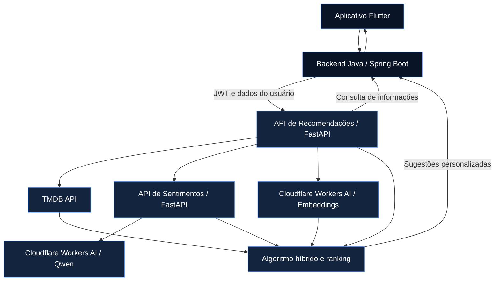

<div align="center">

  <a href="https://github.com/Kaique-Ramiro/recomendador-TvScore">
    
  </a>

  <h1>TV Score — Inteligência Artificial e Recomendações</h1>

  <p><strong>Sua próxima boa história começa aqui.</strong></p>
  <p>Microsserviços em Python para recomendar filmes e séries a partir de preferências, avaliações, sentimentos e similaridade entre sinopses.</p>

  <p>
    
    
    
    
    
  </p>

  <p>
    <a href="https://tvscore-recomendacoes.onrender.com/docs"></a>
    <a href="https://tvscore-sentimentos.onrender.com/docs"></a>
  </p>
  <p>
    <a href="https://github.com/victorbispoo/tvScoreFrontFlutter"></a>
    <a href="https://github.com/GuedesSiilva/BackEnd_Projeto_TvScore"></a>
  </p>

  <p>
    <a href="#sobre-o-projeto">Visão geral</a> ·
    <a href="#como-funciona-a-ia">Inteligência artificial</a> ·
    <a href="#arquitetura">Arquitetura</a> ·
    <a href="#como-executar">Como executar</a>
  </p>
</div>

---

## Sobre o projeto

O **TV Score** é uma plataforma para descobrir, avaliar e receber sugestões personalizadas de filmes e séries, desenvolvida como Trabalho de Conclusão de Curso (TCC) do **SENAI — Técnico em Desenvolvimento de Sistemas**.

Este repositório é dedicado **exclusivamente aos serviços de inteligência artificial e recomendações**, desenvolvidos em **Python e FastAPI**. O aplicativo utiliza **Flutter**, enquanto o backend principal, desenvolvido em **Java/Spring Boot**, gerencia autenticação e dados dos usuários.

O recomendador processa avaliações, favoritos, gêneros e títulos preferidos; consulta o catálogo do **TMDB**; e aplica análise de sentimentos e similaridade semântica com modelos disponibilizados pela **Cloudflare Workers AI**. Os dois serviços Python são publicados separadamente no **Render**.

## Principais funcionalidades

| Funcionalidade | O que faz |
| --- | --- |
| **Recomendações de filmes** | Retorna até 10 sugestões personalizadas de filmes. |
| **Recomendações de séries** | Gera sugestões separadas, utilizando o histórico relacionado a séries. |
| **Análise de sentimentos** | Classifica comentários como `POSITIVO`, `NEGATIVO` ou `NEUTRO`. |
| **Similaridade semântica** | Compara o significado das sinopses por meio de embeddings. |
| **Algoritmo híbrido** | Combina preferências por gêneros, similaridade entre gêneros e notas do TMDB. |
| **Integração com Java** | Consulta avaliações, favoritos e preferências do usuário com autenticação JWT. |
| **Integração com TMDB** | Busca candidatos, sinopses, gêneros, imagens e notas. |
| **Filtragem de conteúdos conhecidos** | Evita sugerir títulos já avaliados, favoritados ou indicados como preferidos. |
| **Justificativas** | Retorna os gêneros relacionados à recomendação e a pontuação de compatibilidade. |

> **Nota:** o *score de recomendação* expressa compatibilidade estimada com um perfil. Ele é diferente da nota dada pelo usuário e da nota pública do TMDB.

## Tecnologias

| Tecnologia | Papel no sistema |
| --- | --- |
| **Python** | Processamento de dados e lógica de recomendação. |
| **FastAPI + Uvicorn** | APIs REST e execução dos serviços. |
| **HTTPX + Asyncio** | Comunicação com Java, TMDB e Cloudflare. |
| **Pydantic** | Validação de dados das requisições. |
| **Cloudflare Workers AI** | Inferência remota de modelos de linguagem e embeddings. |
| **Qwen** | Interpretação dos sentimentos dos comentários. |
| **Qwen3 Embedding** | Representação vetorial e comparação semântica de sinopses. |
| **TMDB API** | Informações de filmes e séries. |
| **Render** | Implantação dos dois serviços Python. |
| **Java, Spring Boot, MySQL e JWT** | Backend principal, persistência e autenticação; não fazem parte deste código Python. |

## Como funciona a IA

### 1. Preferências do usuário

O serviço recebe do backend Java as **avaliações**, os **favoritos**, os **gêneros escolhidos no cadastro** e os **títulos selecionados como preferidos**. Filmes e séries são tratados separadamente.

A pontuação de uma avaliação começa com:

```python
pontos = nota - 5
```

Quando há comentário, o classificador de sentimentos pode acrescentar um ajuste:

| Sentimento | Ajuste |
| --- | ---: |
| Positivo | `+1,5` |
| Neutro | `0` |
| Negativo | `-1,5` |

```python
pontos = nota - 5 + ajuste_sentimento
```

**Exemplo:** uma nota **9** acompanhada de comentário positivo acrescenta `9 - 5 + 1,5 = 5,5` pontos aos gêneros associados.

Outros sinais de preferência também são considerados:

| Interação | Pontuação |
| --- | ---: |
| Favoritar um conteúdo | `+3` por gênero |
| Escolher um gênero no cadastro | `+2` |
| Selecionar um conteúdo preferido no cadastro | `+1` por gênero |

### 2. Análise de sentimentos

O serviço utiliza o modelo **`@cf/qwen/qwen3.8-27b`**, disponível na Cloudflare Workers AI. O comentário é enviado à API e o resultado é uma classificação textual: `POSITIVO`, `NEGATIVO` ou `NEUTRO`.

**Exemplo de requisição:**

```http
POST /sentimentos/analisar
Content-Type: application/json
```

```json
{"comentario": "Esse filme é incrível, adorei a história!"}
```

**Exemplo de resposta:**

```json
{"sentimento": "POSITIVO"}
```

O classificador **não retorna uma porcentagem de confiança**. Caso não exista comentário ou o serviço esteja indisponível, o recomendador pode continuar com os demais sinais de preferência.

### 3. Ranking híbrido

Após reunir as preferências, o serviço consulta o **TMDB**, reúne candidatos, remove conteúdos conhecidos e calcula um score de **0 a 100** com três critérios:

| Critério | Peso |
| --- | ---: |
| Afinidade com gêneros preferidos | **60%** |
| Similaridade entre conjuntos de gêneros | **25%** |
| Nota do TMDB | **15%** |

```text
Score base =
  (afinidade × 60)
  + (similaridade de gêneros × 25)
  + ((nota TMDB / 10) × 15)
```

Os valores de afinidade e similaridade de gêneros usados nessa fórmula são normalizados para o intervalo de 0 a 1.

### 4. Similaridade semântica

Quando existem sinopses de referência, o serviço utiliza o modelo **`@cf/qwen/qwen3-embedding-0.6b`** para gerar *embeddings*: representações numéricas dos textos. A **similaridade do cosseno** é usada para comparar o significado das sinopses.

A etapa semântica complementa o ranking:

```text
Score final =
  (score base × 0,80)
  + (similaridade semântica × 100 × 0,20)
```

Assim, a pontuação utiliza **80% do score base** e **20% da similaridade semântica**, quando esta está disponível. Caso contrário, permanece o score base. Os modelos são **consumidos por API**, e **não foram treinados pela equipe**.

### 5. Resultado

Os candidatos são ordenados pela pontuação. A resposta contém até **10 recomendações por tipo de conteúdo**, com título, gêneros, sinopse, pôster, nota do TMDB, score e justificativa baseada nas preferências.

## Arquitetura



O **backend Java** administra as contas e as informações persistidas em **MySQL**. O **Python** concentra o processamento de recomendações, sentimentos e similaridade, sem substituir o backend principal.

## APIs e endpoints

**Documentação interativa (Swagger):**

- **Recomendações:** https://tvscore-recomendacoes.onrender.com/docs
- **Sentimentos:** https://tvscore-sentimentos.onrender.com/docs

### Serviço de recomendações

| Método | Rota | Finalidade |
| --- | --- | --- |
| `GET` | `/` | Verificação do serviço. |
| `GET` | `/recomendacoes` | Busca por gêneros informados; aceita `quantidade` de 1 a 20. |
| `GET` | `/recomendacoes/personalizadas` | Exemplo de recomendações com dados simulados. |
| `POST` | `/recomendacoes/usuario` | Recomenda filmes a partir de avaliações e favoritos enviados. |
| `POST` | `/recomendacoes/series` | Recomenda séries a partir de dados enviados. |
| `GET` | `/recomendacoes/filmes/java` | Recomenda filmes usando dados reais do backend Java. |
| `GET` | `/recomendacoes/series/java` | Recomenda séries usando dados reais do backend Java. |
| `GET` | `/recomendacoes/teste-java` | Verifica a consulta ao backend Java. |
| `GET` | `/recomendacoes/teste-preparacao` | Inspeciona dados preparados para o algoritmo. |

As rotas integradas ao Java exigem `Authorization: Bearer SEU_TOKEN_JWT`.

### Serviço de sentimentos

| Método | Rota | Finalidade |
| --- | --- | --- |
| `GET` | `/` | Verificação do serviço. |
| `POST` | `/sentimentos/analisar` | Classificação de um comentário. |

O campo `comentario` deve ter **1 a 3.000 caracteres**.

## Como executar

**Pré-requisitos:** Python 3.10 ou superior, Git, conexão com a internet e credenciais válidas para TMDB e Cloudflare. Para as rotas integradas, o backend Java também deve estar acessível.

### 1. Clonar e preparar o ambiente

```bash
git clone https://github.com/Kaique-Ramiro/recomendador-TvScore.git
cd recomendador-TvScore
python -m venv venv
```

Ative o ambiente virtual:

**Windows (PowerShell):**

```powershell
.\venv\Scripts\Activate.ps1
```

**Linux / macOS:**

```bash
source venv/bin/activate
```

Instale as dependências dos dois serviços:

```bash
pip install -r requirements_recomendacoes.txt
pip install -r requirements_sentimentos.txt
```

> Os dois arquivos de dependências descrevem os serviços atualmente publicados. O `requirements.txt` também presente no repositório corresponde a uma implementação anterior com modelos locais.

### 2. Configurar variáveis de ambiente

Crie um arquivo **`.env`** na raiz:

```dotenv
TMDB_API_KEY=SUA_CHAVE_TMDB
JAVA_API_URL=http://localhost:8080
CLOUDFLARE_ACCOUNT_ID=SEU_ACCOUNT_ID
CLOUDFLARE_API_TOKEN=SEU_TOKEN_CLOUDFLARE
SENTIMENTOS_API_URL=http://127.0.0.1:8001
```

**Não publique** o `.env`, tokens JWT ou chaves de API no repositório.

### 3. Iniciar os serviços

Em um terminal, execute a **API de recomendações**:

```bash
uvicorn main_recomendacoes:app --reload --port 8000
```

Em outro terminal, com o mesmo ambiente e dependências instaladas, execute a **API de sentimentos**:

```bash
uvicorn main_sentimentos:app --reload --port 8001
```

Documentação local:

- Recomendações: `http://127.0.0.1:8000/docs`
- Sentimentos: `http://127.0.0.1:8001/docs`

**Execução alternativa:** o arquivo `main.py` também permite disponibilizar os dois conjuntos de rotas em uma aplicação:

```bash
uvicorn main:app --reload --port 8000
```

Nesse caso, ajuste `SENTIMENTOS_API_URL` para o endereço da aplicação que disponibiliza a rota de sentimentos.

## Testes e implantação

Durante o desenvolvimento foram realizados **testes manuais com Swagger**, abrangendo consulta ao Java, integração com o TMDB, geração de recomendações, classificação de sentimentos e uso de embeddings da Cloudflare. Isso **não equivale a uma suíte completa de testes automatizados ou de carga**.

Para verificar a sintaxe dos arquivos Python:

```bash
python -m compileall .
```

| Serviço publicado no Render | Entrada | Comando de inicialização |
| --- | --- | --- |
| [Recomendações](https://tvscore-recomendacoes.onrender.com/docs) | `main_recomendacoes.py` | `uvicorn main_recomendacoes:app --host 0.0.0.0 --port $PORT` |
| [Sentimentos](https://tvscore-sentimentos.onrender.com/docs) | `main_sentimentos.py` | `uvicorn main_sentimentos:app --host 0.0.0.0 --port $PORT` |

A separação permite publicar e executar os dois serviços de modo independente.

## Estrutura do projeto

```text
recomendador-TvScore/
├── main.py                    # Aplicação com ambos os conjuntos de rotas
├── main_recomendacoes.py      # API de recomendações
├── main_sentimentos.py        # API de sentimentos
├── config.py                  # Configurações
├── recomendador.py            # Lógica de preferências e ranking
├── requirements.txt           # Dependências de implementação anterior
├── requirements_recomendacoes.txt
├── requirements_sentimentos.txt
├── models/
│   └── schemas.py             # Esquemas e validação de dados
├── routes/
│   ├── recomendacoes.py       # Endpoints de recomendações
│   └── sentimentos.py         # Endpoint de sentimentos
└── services/
    ├── integracao_java_service.py
    ├── onboarding_service.py
    ├── preparacao_dados_service.py
    ├── recomendacao_service.py
    ├── recomendacao_series_service.py
    ├── sentimento_service.py
    ├── similaridade_service.py
    └── tmdb_service.py
```

## Repositórios relacionados

| Componente | Tecnologia | Repositório |
| --- | --- | --- |
| **Aplicativo Mobile e Web** | Flutter / Dart | [tvScoreFrontFlutter](https://github.com/victorbispoo/tvScoreFrontFlutter) |
| **Backend principal** | Java / Spring Boot | [BackEnd_Projeto_TvScore](https://github.com/GuedesSiilva/BackEnd_Projeto_TvScore) |
| **IA e Recomendações** | Python / FastAPI | [recomendador-TvScore](https://github.com/Kaique-Ramiro/recomendador-TvScore) |

## Créditos e referências

Os dados e imagens de filmes e séries utilizados pelo sistema são fornecidos pelo [TMDB](https://www.themoviedb.org/). **Este produto utiliza a API do TMDB, mas não é endossado nem certificado pelo TMDB.**

Os modelos de IA são acessados por meio da [Cloudflare Workers AI](https://developers.cloudflare.com/workers-ai/). A implantação dos serviços é realizada no [Render](https://render.com/). Consulte também as documentações de [Python](https://www.python.org/), [FastAPI](https://fastapi.tiangolo.com/), [HTTPX](https://www.python-httpx.org/) e [Pydantic](https://docs.pydantic.dev/).

---

<div align="center">
  <strong>TV Score</strong><br />
  Descubra, avalie e encontre sua próxima história favorita.<br />
  <sub>Trabalho de Conclusão de Curso • SENAI • Desenvolvimento de Sistemas</sub>
</div>
